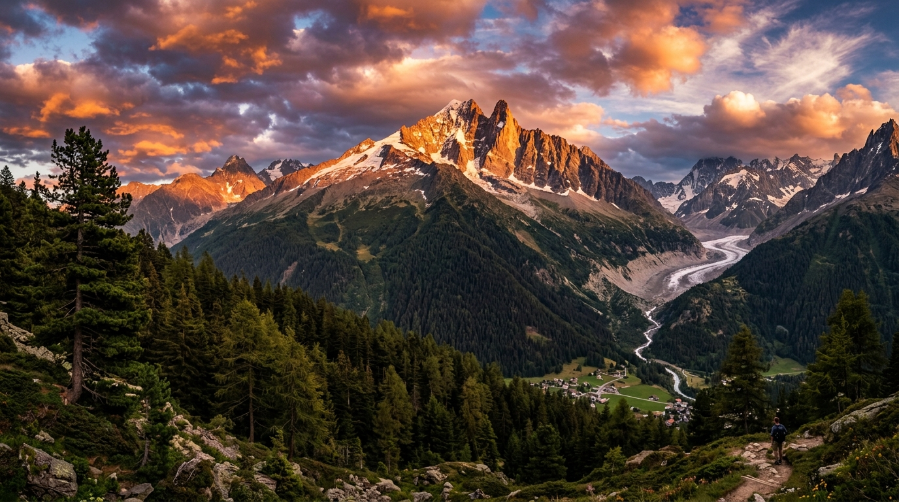

# LumiraRAW Studio - Professional Web RAW Image Processor



**LumiraRAW Studio** is a state-of-the-art, browser-based RAW image editing application and darkroom built with high-performance 16-bit floating point processing, interactive SVG tone curves, HSL color tuning, 3-way split toning color wheels, real-time RGB histogram visualization, and Bayer filter demosaicing inspection.

---

## 🌟 Key Features

- **RAW File Format Ingestion & Demosaicing**:
  - Drag-and-drop support for `.DNG`, `.CR2`, `.NEF`, `.ARW`, `.RAF`, `.ORF`, `.RW2`, `.PEF`, `.TIFF`, `.JPG`, `.PNG`, `.WebP`.
  - Live **Bayer RGGB Sensor Demosaic Matrix Inspector** comparing raw sensor filter grid with reconstructed 16-bit float pixels.
  - Camera EXIF metadata extractor (Camera Model, Lens specification, ISO, Shutter Speed, Aperture, Focal Length, Resolution).

- **High Dynamic Range Exposure & Tone Controls**:
  - **Basic Exposure**: Exposure (EV -5.0 to +5.0), Contrast, Highlights Recovery, Shadows Lifting, Whites, Blacks, Vibrance, Saturation.
  - **White Balance Matrix**: Kelvin Temperature (2000K to 12000K) & Tint color balance adjustment.
  - **Highlight & Shadow Clipping Warning Overlays** (Red highlight clipping & Blue shadow clipping).

- **Interactive Tone Curve Editor**:
  - Vector SVG control handles with monotone cubic spline interpolation across RGB, Red, Green, and Blue channels.

- **8-Band HSL Color Mixer**:
  - Precision Hue Shift, Saturation, and Luminance controls per channel (Reds, Oranges, Yellows, Greens, Aquas, Blues, Purples, Magentas).

- **3-Way Color Grading & Split Toning**:
  - Interactive polar color wheels for **Shadows**, **Midtones**, and **Highlights** with balance control.

- **Detail, Optics & Film Emulations**:
  - Micro-contrast Clarity, Dehaze, Sharpening, Luminance Denoise, Vignette, Lens Distortion, Film Grain.
  - Built-in Film Emulation Presets: *Kodak Portra 400*, *Fuji Velvia 50*, *Tri-X 400 B&W*, *Teal & Orange*, *Moody Forest*, *Kodachrome 64*, *HDR Ultra*.

- **Workspace & Export Engine**:
  - Interactive **Before/After Split View Slider** and Spacebar toggle.
  - Undo / Redo history stack.
  - Preset Sidecar Import & Export in `.JSON` format.
  - Multi-format Export (JPEG with quality control, 16-bit PNG, WebP) with embedded EXIF metadata.

---

## 🚀 Quick Start

1. **Clone the Repository**:
   ```bash
   git clone https://github.com/<username>/RAW-IMAGE-EDITOR.git
   cd RAW-IMAGE-EDITOR
   ```

2. **Serve Locally**:
   Run any standard HTTP server, for example Python 3:
   ```bash
   python3 -m http.server 8085
   ```
   Open `http://localhost:8085` in your browser.

---

## 🎨 Tech Stack

- **HTML5 & Vanilla CSS3**: Custom darkroom design system (`Inter` & `JetBrains Mono` fonts, sleek dark graphite theme).
- **JavaScript ES6+ & HTML5 Canvas2D / WebGL**: High-speed real-time pixel shader pipeline.
- **Lucide Icons**: SVG iconography.

---

## 📄 License

MIT License. Developed for high-performance browser photo processing.
